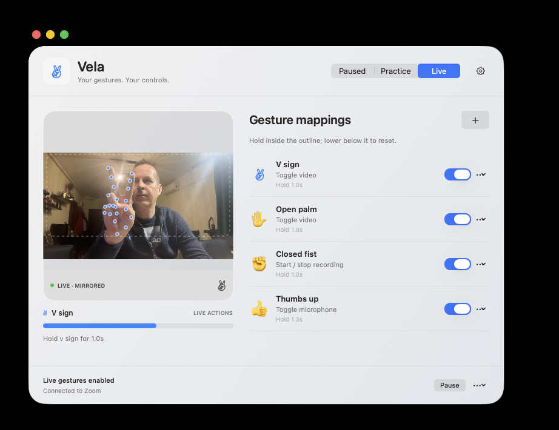

# Vela

### Tinkering with AI, Swift and a webcam

I have been tinkering with AI and Codex to see how far I could take a small idea: could I use the camera already built into my MacBook to recognise a hand gesture and control another application?

There was no particular business problem behind it. I wanted to explore what Apple's frameworks make possible, find out whether the idea could become a usable little app, and learn through the parts that did not work on the first attempt. Zoom became the first application to control: it could keep using my external webcam while Vela watched the built-in camera for gestures.

The result is **Vela**, a native macOS experiment built with Codex. It combines an always-visible camera preview, editable gesture mappings and a simple Paused / Practice / Live mode selector.



[Download the experimental macOS preview](https://github.com/swihpi/vela-gesture-demo/releases/tag/v0.3.1) · [Installation instructions](docs/INSTALL.md) · [Project page](https://swihpi.github.io/vela-gesture-demo/)

**Apple silicon · macOS 14+ deployment target · Not Developer ID signed or Apple-notarised**


## Camera setup: tested with two cameras

I developed and tested Vela using **the MacBook Air's built-in camera for gesture recognition** and **a separate, stand-alone Logitech webcam as Zoom's camera**. Logitech is not a specific requirement; it is the external webcam used in this experiment.

**A single-camera setup might work, or it might not.** We have not verified Vela and Zoom using the same physical camera simultaneously. Camera sharing can depend on macOS, the camera/driver and the applications involved, so single-camera operation is not guaranteed.

This version automatically selects a built-in camera and has no camera picker. An external-only setup without a built-in camera is not currently supported. For the tested arrangement, use the built-in camera for Vela and select a separate webcam in Zoom.

## What Swift and Apple provide—and what I built around them

Swift is the language; **Vision** is the Apple framework doing the hand-pose estimation. This is not a gesture-recognition feature supplied by the Swift language itself.

- **AVFoundation:** an `AVCaptureSession` selects the built-in camera and delivers frames through `AVCaptureVideoDataOutput`. A preview layer displays the live, mirrored image. Zoom separately owns the external webcam feed.
- **Vision:** `VNDetectHumanHandPoseRequest` estimates hand joint positions and confidence values. Vela uses those landmarks to recognise a V sign, open palm, closed fist and thumbs up. Apple provides the pose estimator; the gesture rules, active area, smoothing, hold timing and release-to-reset logic are implemented in this project.
- **SwiftUI:** builds the native interface, live feedback and editable mapping controls. Mappings are encoded with `Codable` and stored locally in `UserDefaults`.
- **AppKit:** supplies the Mac window, standard window controls, Dock/menu bar integration and the camera preview bridge.
- **macOS Accessibility:** reads Zoom's own controls and their current state. Where needed, Vela sends Zoom's menu keyboard accelerator and checks the result. This is desktop automation, not an official Zoom SDK integration.

No custom hand model was trained, and camera frames are not sent to a cloud AI service for recognition. Codex helped with building and iterating on the application; it is not a runtime dependency of Vela.

Apple references: [hand-pose detection](https://developer.apple.com/documentation/vision/vndetecthumanhandposerequest), [capture sessions](https://developer.apple.com/documentation/avfoundation/avcapturesession), [video preview layers](https://developer.apple.com/documentation/avfoundation/avcapturevideopreviewlayer), [SwiftUI](https://developer.apple.com/documentation/swiftui), [AppKit](https://developer.apple.com/documentation/appkit).

## Current gesture mappings

| Gesture | Default action |
| --- | --- |
| V sign | Toggle Zoom video on/off |
| Open palm | Toggle Zoom video on/off |
| Closed fist | Request start/stop of Zoom computer recording |
| Thumbs up | Toggle microphone mute/unmute |

Both V sign and open palm toggle video intentionally. Each mapping can be edited, disabled or deleted, and hold durations can be adjusted. Only one enabled mapping per gesture is allowed. Multiple gestures can share an action.

Raise your hand into the outlined area, hold until the progress bar completes, then lower your hand below the area before the next action. Natural thumb positions are accepted for an open palm.

**Paused** keeps the preview live without sending commands. **Practice** tests gestures without changing Zoom. **Live** enables the mapped actions. Editing a mapping pauses live actions while leaving the preview on. Control–Option–Command–G pauses gestures immediately if the shortcut can be registered.

## What the experiment taught me

The interesting part was the iteration. A hand-pose estimate is only the beginning: I needed to prevent repeated triggers, account for natural thumb positions, distinguish a raised hand from one resting on the desk, and make mode selection unambiguous. macOS permissions also needed attention: replacing a running, differently signed development build could leave Accessibility approval tied to a stale code identity.

Those rough edges are part of the example. The repository shows the application code and deterministic checks, not a claim that an AI-generated application is automatically finished or production-ready.

## Privacy and permissions

Vela analyses camera frames locally and does not save or upload those frames. It does not capture microphone audio, require an API key or depend on a server. Camera permission enables capture; Accessibility permission allows operating Zoom. Numeric developer diagnostics exist behind an explicit launch flag and are off during normal use.

Meeting recordings requested through the fist gesture are made and saved by **Zoom**, according to Zoom's settings, host permissions and confirmations. Vela does not bypass those permissions.

A self-preview may be visible when sharing your whole screen. Apple or Zoom automatic gesture reactions can also respond to the same physical gestures.

## Status and limitations

This is an **experimental reference application**, not a business solution or an officially supported Zoom integration.

- The deployment target is macOS 14+, Apple silicon. Development testing was on macOS 26.6.2; other versions and models have not been independently verified.
- Zoom's English-language menus and controls are supported. A Zoom update can change them.
- Lighting, hand position and occlusion affect recognition. A built-in camera must be available and the laptop lid open.
- 57 deterministic gesture/mapping checks passed. The four gesture recognisers were also tried interactively during development, including adjustments for the open palm.
- The final recording toggle has not yet been verified end to end in a separate release-acceptance test. Host permissions and Zoom prompts remain relevant.
- This release is not Developer ID signed or Apple-notarised. Follow the app-specific [installation instructions](docs/INSTALL.md) only if you trust the release. A clean-Mac/quarantined-download installation has not yet been independently tested.
- Extending Vela to another application requires implementing and testing that application's control path. Arbitrary custom gesture training is not included.

## Build, inspect and adapt

See [BUILDING.md](BUILDING.md). The project uses Swift Package Manager and has no external package dependencies.

```sh
swift run --disable-sandbox GestureChecks
```

The public source excludes local signing identities, private keys, account credentials, camera images, diagnostic output and build caches. Public DMG builds use ad-hoc signing; no development certificate or private key is needed to reproduce them.

## Licence and attribution

MIT licensed. Built with Codex, Swift and Apple's macOS frameworks. Independent project; not affiliated with or endorsed by OpenAI, Apple or Zoom.
